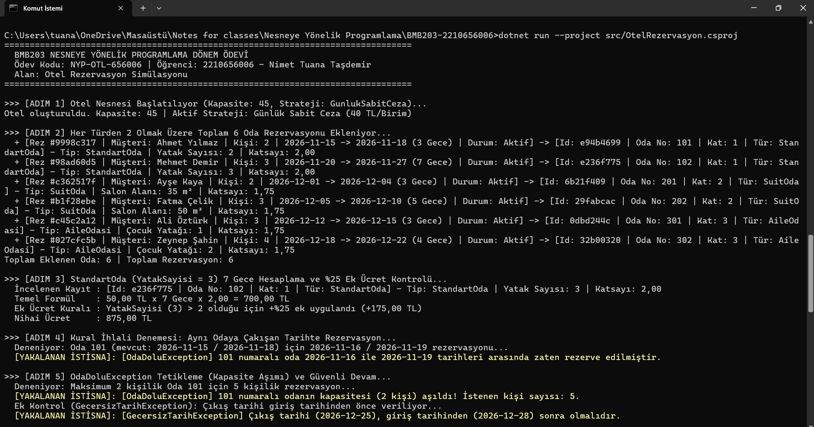
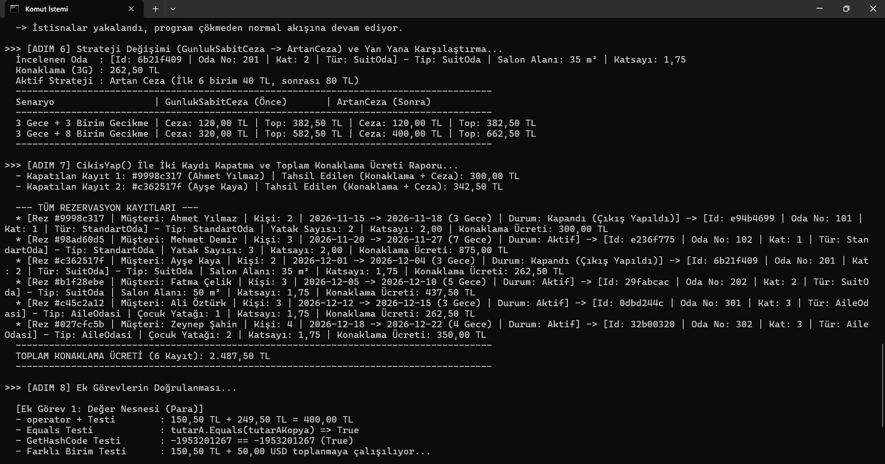
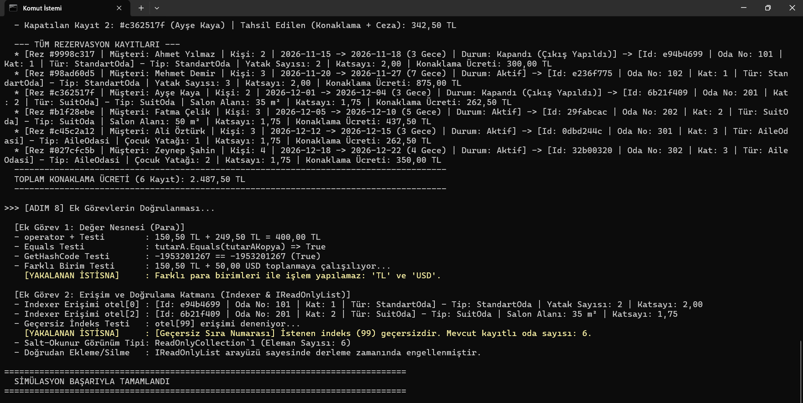

# BMB203 Nesneye Yönelik Programlama Dönem Ödevi

## Öğrenci ve Ödev Bilgileri
- **Ödev Kodu:** NYP-OTL-656006
- **Öğrenci No:** 2210656006
- **Ad Soyad:** Nimet Tuana Taşdemir
- **Alan:** Otel Rezervasyon Simülasyonu
- **Dil:** C# (.NET 8.0)

## Derleme ve Çalıştırma
Proje yalnızca .NET 8 standart kütüphanesini kullanır; harici paket, çatı veya veritabanı gerektirmez. Proje ana dizininde aşağıdaki komutlarla derlenip çalıştırılabilir:

```bash
dotnet build src/OtelRezervasyon.csproj
dotnet run --project src/OtelRezervasyon.csproj
```

## UML Sınıf Diyagramı


## Main Senaryosu Tam Konsol Çıktısı
```text
================================================================================
  BMB203 NESNEYE YÖNELİK PROGRAMLAMA DÖNEM ÖDEVİ
  Ödev Kodu: NYP-OTL-656006 | Öğrenci: 2210656006 - Nimet Tuana Taşdemir
  Alan: Otel Rezervasyon Simülasyonu
================================================================================

>>> [ADIM 1] Otel Nesnesi Başlatılıyor (Kapasite: 45, Strateji: GunlukSabitCeza)...
Otel oluşturuldu. Kapasite: 45 | Aktif Strateji: Günlük Sabit Ceza (40 TL/Birim)

>>> [ADIM 2] Her Türden 2 Olmak Üzere Toplam 6 Oda Rezervasyonu Ekleniyor...
  + [Rez #a1b2c3d4 | Müşteri: Ahmet Yılmaz | Kişi: 2 | 2026-11-15 -> 2026-11-18 (3 Gece) | Durum: Aktif] -> [Id: 11aa22bb | Oda No: 101 | Kat: 1 | Tür: StandartOda] - Tip: StandartOda | Yatak Sayısı: 2 | Katsayı: 2,00
  + [Rez #e5f6a7b8 | Müşteri: Mehmet Demir | Kişi: 3 | 2026-11-20 -> 2026-11-27 (7 Gece) | Durum: Aktif] -> [Id: 22bb33cc | Oda No: 102 | Kat: 1 | Tür: StandartOda] - Tip: StandartOda | Yatak Sayısı: 3 | Katsayı: 2,00
  + [Rez #c9d0e1f2 | Müşteri: Ayşe Kaya | Kişi: 2 | 2026-12-01 -> 2026-12-04 (3 Gece) | Durum: Aktif] -> [Id: 33cc44dd | Oda No: 201 | Kat: 2 | Tür: SuitOda] - Tip: SuitOda | Salon Alanı: 35 m² | Katsayı: 1,75
  + [Rez #3456abcd | Müşteri: Fatma Çelik | Kişi: 3 | 2026-12-05 -> 2026-12-10 (5 Gece) | Durum: Aktif] -> [Id: 44dd55ee | Oda No: 202 | Kat: 2 | Tür: SuitOda] - Tip: SuitOda | Salon Alanı: 50 m² | Katsayı: 1,75
  + [Rez #7890ef12 | Müşteri: Ali Öztürk | Kişi: 3 | 2026-12-12 -> 2026-12-15 (3 Gece) | Durum: Aktif] -> [Id: 55ee66ff | Oda No: 301 | Kat: 3 | Tür: AileOdasi] - Tip: AileOdasi | Çocuk Yatağı: 1 | Katsayı: 1,75
  + [Rez #90ab34cd | Müşteri: Zeynep Şahin | Kişi: 4 | 2026-12-18 -> 2026-12-22 (4 Gece) | Durum: Aktif] -> [Id: 66ff77aa | Oda No: 302 | Kat: 3 | Tür: AileOdasi] - Tip: AileOdasi | Çocuk Yatağı: 2 | Katsayı: 1,75
Toplam Eklenen Oda: 6 | Toplam Rezervasyon: 6

>>> [ADIM 3] StandartOda (YatakSayisi = 3) 7 Gece Hesaplama ve %25 Ek Ücret Kontrolü...
  İncelenen Kayıt : [Id: 22bb33cc | Oda No: 102 | Kat: 1 | Tür: StandartOda] - Tip: StandartOda | Yatak Sayısı: 3 | Katsayı: 2,00
  Temel Formül    : 50,00 TL x 7 Gece x 2,00 = 700,00 TL
  Ek Ücret Kuralı : YatakSayisi (3) > 2 olduğu için +%25 ek uygulandı (+175,00 TL)
  Nihai Ücret     : 875,00 TL

>>> [ADIM 4] Kural İhlali Denemesi: Aynı Odaya Çakışan Tarihte Rezervasyon...
  Deneniyor: Oda 101 (mevcut: 2026-11-15 / 2026-11-18) için 2026-11-16 / 2026-11-19 rezervasyonu...
  [YAKALANAN İSTİSNA]: [OdaDoluException] 101 numaralı oda 2026-11-16 ile 2026-11-19 tarihleri arasında zaten rezerve edilmiştir.

>>> [ADIM 5] OdaDoluException Tetikleme (Kapasite Aşımı) ve Güvenli Devam...
  Deneniyor: Maksimum 2 kişilik Oda 101 için 5 kişilik rezervasyon...
  [YAKALANAN İSTİSNA]: [OdaDoluException] 101 numaralı odanın kapasitesi (2 kişi) aşıldı! İstenen kişi sayısı: 5.
  Ek Kontrol (GecersizTarihException): Çıkış tarihi giriş tarihinden önce veriliyor...
  [YAKALANAN İSTİSNA]: [GecersizTarihException] Çıkış tarihi (2026-12-25), giriş tarihinden (2026-12-28) sonra olmalıdır.
  -> İstisnalar yakalandı, program çökmeden normal akışına devam ediyor.

>>> [ADIM 6] Strateji Değişimi (GunlukSabitCeza -> ArtanCeza) ve Yan Yana Karşılaştırma...
  İncelenen Oda  : [Id: 33cc44dd | Oda No: 201 | Kat: 2 | Tür: SuitOda] - Tip: SuitOda | Salon Alanı: 35 m² | Katsayı: 1,75
  Konaklama (3G) : 262,50 TL
  Aktif Strateji : Artan Ceza (İlk 6 birim 40 TL, sonrası 80 TL)
  --------------------------------------------------------------------------------------
  Senaryo                  | GunlukSabitCeza (Önce)       | ArtanCeza (Sonra)           
  --------------------------------------------------------------------------------------
  3 Gece + 3 Birim Gecikme | Ceza: 120,00 TL | Top: 382,50 TL | Ceza: 120,00 TL | Top: 382,50 TL
  3 Gece + 8 Birim Gecikme | Ceza: 320,00 TL | Top: 582,50 TL | Ceza: 400,00 TL | Top: 662,50 TL
  --------------------------------------------------------------------------------------

>>> [ADIM 7] CikisYap() İle İki Kaydı Kapatma ve Toplam Konaklama Ücreti Raporu...
  - Kapatılan Kayıt 1: #a1b2c3d4 (Ahmet Yılmaz) | Tahsil Edilen (Konaklama + Ceza): 300,00 TL
  - Kapatılan Kayıt 2: #c9d0e1f2 (Ayşe Kaya) | Tahsil Edilen (Konaklama + Ceza): 342,50 TL

  --- TÜM REZERVASYON KAYITLARI ---
  * [Rez #a1b2c3d4 | Müşteri: Ahmet Yılmaz | Kişi: 2 | 2026-11-15 -> 2026-11-18 (3 Gece) | Durum: Kapandı (Çıkış Yapıldı)] -> [Id: 11aa22bb | Oda No: 101 | Kat: 1 | Tür: StandartOda] - Tip: StandartOda | Yatak Sayısı: 2 | Katsayı: 2,00 | Konaklama Ücreti: 300,00 TL
  * [Rez #e5f6a7b8 | Müşteri: Mehmet Demir | Kişi: 3 | 2026-11-20 -> 2026-11-27 (7 Gece) | Durum: Aktif] -> [Id: 22bb33cc | Oda No: 102 | Kat: 1 | Tür: StandartOda] - Tip: StandartOda | Yatak Sayısı: 3 | Katsayı: 2,00 | Konaklama Ücreti: 875,00 TL
  * [Rez #c9d0e1f2 | Müşteri: Ayşe Kaya | Kişi: 2 | 2026-12-01 -> 2026-12-04 (3 Gece) | Durum: Kapandı (Çıkış Yapıldı)] -> [Id: 33cc44dd | Oda No: 201 | Kat: 2 | Tür: SuitOda] - Tip: SuitOda | Salon Alanı: 35 m² | Katsayı: 1,75 | Konaklama Ücreti: 262,50 TL
  * [Rez #3456abcd | Müşteri: Fatma Çelik | Kişi: 3 | 2026-12-05 -> 2026-12-10 (5 Gece) | Durum: Aktif] -> [Id: 44dd55ee | Oda No: 202 | Kat: 2 | Tür: SuitOda] - Tip: SuitOda | Salon Alanı: 50 m² | Katsayı: 1,75 | Konaklama Ücreti: 437,50 TL
  * [Rez #7890ef12 | Müşteri: Ali Öztürk | Kişi: 3 | 2026-12-12 -> 2026-12-15 (3 Gece) | Durum: Aktif] -> [Id: 55ee66ff | Oda No: 301 | Kat: 3 | Tür: AileOdasi] - Tip: AileOdasi | Çocuk Yatağı: 1 | Katsayı: 1,75 | Konaklama Ücreti: 262,50 TL
  * [Rez #90ab34cd | Müşteri: Zeynep Şahin | Kişi: 4 | 2026-12-18 -> 2026-12-22 (4 Gece) | Durum: Aktif] -> [Id: 66ff77aa | Oda No: 302 | Kat: 3 | Tür: AileOdasi] - Tip: AileOdasi | Çocuk Yatağı: 2 | Katsayı: 1,75 | Konaklama Ücreti: 350,00 TL
  --------------------------------------------------------------------------------------
  TOPLAM KONAKLAMA ÜCRETİ (6 Kayıt): 2.487,50 TL
  --------------------------------------------------------------------------------------

>>> [ADIM 8] Ek Görevlerin Doğrulanması...

  [Ek Görev 1: Değer Nesnesi (Para)]
  - operator + Testi        : 150,50 TL + 249,50 TL = 400,00 TL
  - Equals Testi            : tutarA.Equals(tutarAKopya) => True
  - GetHashCode Testi       : True
  - Farklı Birim Testi      : 150,50 TL + 50,00 USD toplanmaya çalışılıyor...
    [YAKALANAN İSTİSNA]     : Farklı para birimleri ile işlem yapılamaz: 'TL' ve 'USD'.

  [Ek Görev 2: Erişim ve Doğrulama Katmanı (Indexer & IReadOnlyList)]
  - Indexer Erişimi otel[0] : [Id: 11aa22bb | Oda No: 101 | Kat: 1 | Tür: StandartOda] - Tip: StandartOda | Yatak Sayısı: 2 | Katsayı: 2,00
  - Indexer Erişimi otel[2] : [Id: 33cc44dd | Oda No: 201 | Kat: 2 | Tür: SuitOda] - Tip: SuitOda | Salon Alanı: 35 m² | Katsayı: 1,75
  - Geçersiz İndeks Testi   : otel[99] erişimi deneniyor...
    [YAKALANAN İSTİSNA]     : [Geçersiz Sıra Numarası] İstenen indeks (99) geçersizdir. Mevcut kayıtlı oda sayısı: 6.
  - Salt-Okunur Görünüm Tipi: ReadOnlyCollection`1 (Eleman Sayısı: 6)
  - Doğrudan Ekleme/Silme   : IReadOnlyList arayüzü sayesinde derleme zamanında engellenmiştir.

================================================================================
  SİMÜLASYON BAŞARIYLA TAMAMLANDI
================================================================================
```

### Konsol Ekran Görüntüsü




## Tasarım Soruları

### 1. Neden `abstract` sınıf, neden `interface` kullandınız?
- **`abstract class Oda` kullanımı:** `StandartOda`, `SuitOda` ve `AileOdasi` sınıfları arasında güçlü bir "bir türüdür (is-a)" ilişkisi ve ortak veri durumu (state) bulunur. `Id`, `OdaNo` ve `Kat` gibi `private` alanların doğrulamalı property'lerle kapsüllenmesi, ortak `BirimFiyat` (50 TL) sabiti ve temel `ToString()` biçimi tüm odalarda ortaktır. Kod tekrarını önlemek, `base(...)` constructor zinciri ile ortak doğrulamaları tek merkezde toplamak ve alt sınıfları `Hesapla(int gece)` metodunu uygulamaya zorlamak için `abstract` sınıf tercih edilmiştir.
- **`interface ICezaPolitikasi` kullanımı:** `CezaYok`, `GunlukSabitCeza` ve `ArtanCeza` sınıfları ortak bir nesne kimliği veya alan durumu paylaşmaz; yalnızca tek bir davranış sözleşmesini (`Ceza(int gecikme)`) yerine getirir. `Otel` sınıfı somut ceza sınıflarına değil bu arayüze bağımlı (Dependency Injection) hâle getirilerek Strateji Deseni uygulanmış ve çalışma zamanında `CezaPolitikasiDegistir()` metoduyla politikanın dinamik olarak değiştirilebilmesi sağlanmıştır.

### 2. Sınıf değişmezlerinizi hangi noktalarda korudunuz?
- **Otel kapasite değişmezi (Maksimum 45 oda):** `Otel` constructor'ında kapasitenin 1 ile 45 arasında olması denetlenir; ayrıca `Otel.OdaKaydet()` metodunda `_odalar.Count >= _kapasite` kontrolü yapılarak 45 oda sınırının aşılması `OdaDoluException` ile engellenir.
- **Aynı odada tarih çakışması değişmezi:** `Otel.RezervasyonYap()` metodunda ilgili odaya ait aktif rezervasyonlar `Rezervasyon.TarihCakisiyorMu()` ile kontrol edilir; tarih çakışması varsa `OdaDoluException` fırlatılır.
- **Kişi sayısı oda kapasitesi değişmezi:** `Rezervasyon` constructor'ında `kisiSayisi > _rezerveOda.MaksimumKapasite` denetimi yapılarak oda kapasitesini aşan bir rezervasyon nesnesinin oluşturulması `OdaDoluException` ile engellenir.
- **Geçerli tarih ve alan aralığı değişmezleri:** `Rezervasyon` constructor'ında çıkış tarihinin giriş tarihinden önce veya aynı gün olması `GecersizTarihException` fırlatır. `Oda` ve alt sınıflarının property setter'larında geçerli aralıklar (`YatakSayisi`: 1–3, `SalonM2`: 15–60, `CocukYatagi`: 1–3) nesne oluşturulurken doğrulanır.
- **Koleksiyon ve parasal bütünlük:** `_odalar` ve `_rezervasyonlar` listeleri `private` tutulup dışarıya yalnızca `AsReadOnly()` ile `IReadOnlyList` görünümü verilir; `Otel` indexer erişiminde geçersiz indeksler yakalanır. `Para` tipi `readonly record struct` olarak tanımlanarak negatif tutarlar ve farklı para birimlerinin toplanması engellenir.

### 3. Yeni bir alt tür eklemek için hangi dosyalara dokunmak gerekir?
Sistem Açık/Kapalı Prensibi'ne (Open/Closed Principle) uygun kurgulandığı için yeni bir oda alt türü (örneğin `KralDairesi`) eklemek amacıyla mevcut çekirdek sınıflarda değişiklik yapmaya gerek yoktur:
- Yalnızca `src/Models/KralDairesi.cs` adında yeni bir dosya oluşturulur; `Oda` sınıfından türetilir ve kendi alan doğrulaması ile `TurKatsayisi`, `MaksimumKapasite`, `Hesapla(int gece)` ve `ToString()` üyeleri override edilir.
- `Otel` (`src/Services/Otel.cs`) ve `Rezervasyon` (`src/Models/Rezervasyon.cs`) sınıfları soyut `Oda` taban sınıfı üzerinden polimorfik çalıştığı için bu dosyalara dokunulmaz. Yeni sınıfı kullanmak için yalnızca çağrı noktasına (örneğin `src/Program.cs`) yeni nesne örneği eklenir. Benzer şekilde yeni bir ceza politikası eklemek için de yalnızca `src/Strategies/` altında `ICezaPolitikasi` arayüzünü uygulayan yeni bir sınıf dosyası eklenmesi yeterlidir.


## Yapay Zekâ Kullanım Beyanı
Bu ödevin geliştirilme sürecinde **Google Gemini** aracından aşağıdaki amaçlarla yararlanılmıştır:
- Ödev föyüne uygun 8 günlük çalışma planının ve nesneye yönelik sınıf tasarımının (kapsülleme, kalıtım, strateji deseni ve DI) planlanması,
- C# dilinde `readonly record struct` (`Para`), indexer ve `IReadOnlyList` kullanımı ile Git komutlarında hata ayıklama desteği,
- UML sınıf diyagramı sözdiziminin (Mermaid) düzenlenmesi.

Tüm kaynak kodlar yerel ortamda adım adım uygulanmış, derlenmiş ve çalıştırılarak test edilmiştir.

